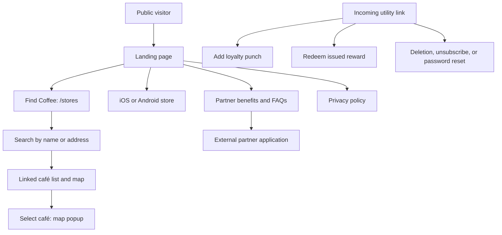
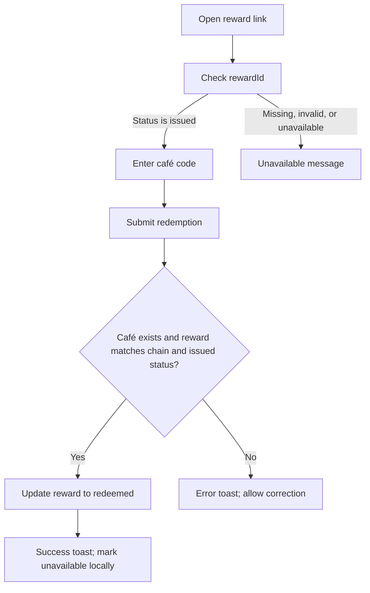

# Coffee Sphut — App Flow

Last reviewed: October 22, 2026

## Purpose and scope

This document maps the journeys implemented in this Next.js repository: the public website, store finder, reward utility pages, account-support pages, and staff management portal. It is based on source inspection, not a live production or backend verification.

The website promotes the Coffee Sphut mobile app for café discovery, curated content, favourites, and loyalty. Mobile onboarding, content reading, favourites, and reward issuance are not implemented as consumer web journeys here. App-store links hand users off to that separate product.

See [UI_UX_DESIGN_BRRIEF.md](UI_UX_DESIGN_BRRIEF.md) for visual direction, interaction requirements, and proposed improvements. Sections below describe current behavior unless explicitly labelled as a gap or recommendation.

## Audiences and access

| Audience | Main goal | Access |
| --- | --- | --- |
| Visitor or coffee enthusiast | Understand Coffee Sphut, find cafés, download the app | Public website; no web sign-in required |
| Prospective café partner | Understand benefits and apply to join | Public partner section; external Google Form |
| Café staff using a reward link | Punch a customer's card or redeem an issued reward | Public utility page with link context and a café code |
| Account holder or waitlist subscriber | Request deletion, unsubscribe, or reset a password | Public utility pages; password update requires a valid Supabase auth context |
| Editor | Maintain cafés and editorial content | Authenticated user on the `AdminUser` allow-list |
| Admin | Editor tasks plus users, loyalty, team, waitlist, and audit management | Authenticated allow-listed user with the `admin` role |

Café staff using reward links are distinct from the portal's `editor` and `admin` roles. The repository has no separate vendor dashboard or vendor sign-up route.

## Route map

### Public and utility routes

| Route | Purpose | Main next step |
| --- | --- | --- |
| `/` | Product introduction, feature previews, partner benefits, FAQs, downloads | `/stores`, app store, or external partner application |
| `/stores` | Search cafés and explore linked map/list results | Select a café to show its map popup |
| `/stores?q=<query>` | Store finder with a shareable search term | Refine or clear the search |
| `/privacy` | Privacy policy | Read policy; no transaction |
| `/vendor_reward?firstName=…&userId=…` | Add a loyalty punch for the linked customer | Enter café code and submit |
| `/redeem_reward?firstName=…&cafeChain=…&rewardId=…` | Check and redeem an issued reward | Enter café code and submit |
| `/delete-account` | Submit an account deletion request | Enter email, first name, and last name |
| `/unsubscribe` | Remove an email from the waiting list | Confirm email and submit |
| `/reset-password` | Update the password for the current auth context | Save new password |

Reward-link origins are outside this repository. QR-based loyalty is described in partner copy, but link generation and scanning are not implemented here. Display names in query parameters provide presentation context; they should not be treated as proof of identity.

### Staff routes

Next.js route groups such as `(auth)` and `(dashboard)` do not appear in URLs.

| Route | Minimum role | Purpose |
| --- | --- | --- |
| `/admin/login` | Public | Email/password or Google sign-in |
| `/admin/forgot-password` | Public | Request a password recovery email |
| `/admin/auth/callback` | Auth callback | Exchange Google OAuth code and check staff access |
| `/admin` | Editor | Summary metrics, activity and content shortcuts |
| `/admin/cafes`, `/admin/chains` | Editor | Manage cafés, café details, menus, and chains |
| `/admin/posts`, `/admin/recipes`, `/admin/events` | Editor | Manage editorial content and publishing |
| `/admin/authors`, `/admin/categories`, `/admin/questions` | Editor | Manage supporting content and onboarding questions |
| `/admin/users`, `/admin/users/[id]` | Admin | Search users and manage onboarding and loyalty |
| `/admin/waitlist` | Admin | Search entries, export CSV, remove entries |
| `/admin/team` | Admin | Add/invite staff and manage permissions |
| `/admin/activity` | Admin | Inspect audit activity |

Each content-management collection above, from cafés through questions, has a `/new` creation URL and a `/[id]` editing URL. The dynamic `[id]` page handles the `new` value. Record deletion is restricted to admins, including menu-item deletion.

## Journey overview

## 1. Discover the product and download the app

1. Enter `/` and see the sticky site header, product proposition, and rotating mobile-app screenshots.
2. Use header anchors for Features, App, Partners, or Download. On small screens, these links and download buttons are available in a right-side menu sheet.
3. Scroll through feature cards, app previews, partner benefits, partner logos, partner FAQs, and the download section. A hiring section appears only when job postings exist; the current list is empty.
4. Choose **Find Coffee** to open `/stores`, or choose an iOS/Android button to open its configured store listing in a new tab.
5. The footer links to the privacy policy and social profiles. Its **Contact Us** link currently scrolls to the partner section.

Download clicks emit the existing `Download` analytics event. Header store-finder clicks emit `Find Coffee`. These are click signals; they do not verify app installation or a café visit.

## 2. Find a café

1. Open `/stores`, optionally with a `q` query parameter. The server loads up to 100 café records; the initial query is cached for five minutes.
2. The client requests browser geolocation once. If granted, results gain distances and are sorted by proximity. If denied, unsupported, or timed out, browsing continues without a user-location marker.
3. Search by name or address. Input is debounced by 300 ms, synchronized to `q` using URL replacement, and sent to the `get_closest_cafes` RPC. Search uses the user's coordinates when available, otherwise the Lagos fallback center at `6.5244, 3.3792`.
4. While searching, show a spinner and “Searching…” text and dim the existing results. Stale responses are ignored when a newer request has started.
5. Select a list card or map point to select the same café and show its name, address, and available distance in a popup. Clicking a map cluster zooms into its cafés.
6. Clear the query to restore the initial café list. When location is available, the recenter control returns the map to the user and clears the selection.

On desktop, the list sits beside the map. On small screens, the map appears above the search and list. Selection stays within this page: there is no public café-detail route, directions action, or web favourite control.

| Condition | Current outcome |
| --- | --- |
| Initial/loading boundary or map module loading | Skeleton or loading placeholder |
| No query matches | “No stores match…” with the query |
| No initial records | “No coffee shops found yet.” |
| Geolocation unavailable | Continue browsing; use fallback coordinates for search |
| Missing Mapbox token | Map-unavailable panel; list remains usable |
| Café fetch/search failure | Server logs the error and returns an empty array; UI cannot distinguish failure from no results |

## 3. Apply as a café partner

1. Reach `/#partners` from navigation or the footer.
2. Review benefits, existing partners, and the partner FAQs at `/#FAQs`.
3. Choose **Join Our Partner Network**. The site emits `Signup` and opens the configured Google Form in a new tab.
4. Application completion and follow-up happen outside this repository. There is no local confirmation page or persisted application status.

Partner copy describes analytics and loyalty capabilities; it does not establish a self-service web portal for partners.

## 4. Punch a customer's loyalty card

1. Open `/vendor_reward` with `firstName` and `userId`. Missing either produces an invalid-link message.
2. Show the customer's supplied first name and request the café code.
3. Submit **Punch reward card**. Disable the button and display “Punching card…”.
4. Resolve the café by `reward_code`, then insert a `RewardTransaction` with the supplied user ID and resolved café ID.
5. On success, show a toast and reset the form. A returned failure shows an error toast; unexpected thrown errors are currently only logged.

The page remains available for another submission. Duplicate-punch prevention and reward-issuance rules cannot be inferred from this page alone and need backend confirmation.

## 5. Redeem a reward

The link supplies `rewardId`, `firstName`, and `cafeChain`. Availability checks use the reward ID; the name and chain label are displayed context. The server resolves the entered café code and updates only the matching reward whose chain matches and whose status is still `issued`.

The page shows an initial spinner and a pending submit label. Its generic unavailable copy currently assumes the reward has been redeemed even when it might be missing or otherwise unavailable. The availability request runs during rendering, which can cause repeated checks; a dedicated one-time or controlled check is a recommended correction.

## 6. Account and subscription support

| Journey | Input and action | Success | Failure/current limitation |
| --- | --- | --- | --- |
| Account deletion | Submit required email, first name, and last name to `delete-account-request` | Toast confirms receipt of a deletion request; reset form | Error toast and retry; actual deletion completion is outside this page |
| Waitlist unsubscribe | Submit required email to the `wishlist` Edge Function using DELETE | Removal toast and reset form | Error toast and retry |
| Staff password recovery | From `/admin/forgot-password`, submit email to Supabase Auth | Recovery-email success state | Inline error on failure; email delivery and recovery-link behavior require integration verification |
| Password reset | Open `/reset-password` with valid auth context and submit a new password | Update current user's password, then navigate to `https://coffeesphut.com/home` | Inline error; `/home` has no route in this checkout, and recovery-session establishment is not handled by this page |

A waitlist subscription server helper also exists, but there is no active public subscription form in the inspected landing page.

## 7. Staff authentication and authorization

1. Open `/admin` or another protected staff route. An unauthenticated request redirects to `/admin/login`, carrying the requested pathname in `redirectTo`.
2. Sign in with email/password or Google. Both paths require membership in `AdminUser`; successful authentication alone does not grant staff access.
3. Password sign-in checks staff membership directly. Google returns through `/admin/auth/callback`, exchanges the code for a session, and checks the allow-list. A non-staff user is signed out and sent back to login.
4. Valid staff are sent to a safe admin destination. Editors can open shared management pages; admin-only pages and actions enforce their role on the server.
5. An editor attempting an admin-only page is redirected to `/admin?error=forbidden`. Sign-out clears the session and returns to `/admin/login`.

Staff login activity is recorded. The session proxy handles admin paths; the dashboard layout and server actions perform additional staff/role checks.

## 8. Maintain cafés and publish content

1. From the dashboard, choose a management collection and review its records. Café filters include text, chain, active status, and detail visibility.
2. Open a record or choose its creation action. Café editing covers identity, chain, loyalty settings, location, contact details, amenities, hours, images, and menu items.
3. Save changes. The corresponding server action validates access, writes the record, revalidates affected pages, and generally returns to the collection. Menu and image operations have their own controls.
4. For existing posts, recipes, and events, use publishing controls to publish now, schedule a date, or unpublish to draft.
5. Admins can delete records through confirmation controls; editors cannot perform deletion actions.

Publishing state is derived from `published_at`: `null` is Draft, a future timestamp is Scheduled, and a timestamp at or before the current time is Published. This repository writes that state; consumer content visibility must also be enforced by the consuming app and backend. No public post, recipe, or event reader is implemented here.

## 9. Admin operations

- **Users and loyalty:** Search/filter users, inspect a user's onboarding and loyalty details, reset onboarding, adjust punch counts, or void an issued reward. The latter three actions require an audit reason and call dedicated admin RPCs.
- **Waitlist:** Search email addresses, remove an entry after confirmation, or export CSV. Export includes all loaded entries, even when the visible table is filtered.
- **Team:** Add an existing user or invite by email, choose Editor/Admin, change a member's role, or remove access. The actions block self-demotion and self-removal. Inviting a new user uses Supabase's invitation service.
- **Activity:** Review the audit log. Dashboard summaries also show recent activity for admins.

Some user metrics and invitation capabilities depend on a configured service-role client. Missing configuration can produce reduced data or a provisioning error; it should not be presented as verified absence of users.

## Gaps to resolve in subsequent implementation

1. Complete and verify password recovery end to end; replace the reset success destination with an implemented route.
2. Give reward checks a controlled lifecycle, actionable invalid-link states, and visible feedback for thrown errors.
3. Separate store-service failure from a valid empty result and offer retry.
4. Provide staff navigation on small screens; the current full sidebar is hidden below `lg` without an equivalent menu.
5. Confirm public café visibility rules: the initial café fetch does not explicitly filter `is_active` or `show_details`.
6. Validate backend reward rules and app handoffs before extending the documented web journey to cover issuance, QR generation, or favourites.

## Source map

- Public site: `app/page.tsx`, `app/constants.tsx`, `components/site-header.tsx`, `components/hero-carousel.tsx`.
- Store discovery: `app/stores/`, `components/store-finder.tsx`, `components/store-search.tsx`, `components/store-list.tsx`, `components/store-map.tsx`, `hooks/use-user-location.ts`, `lib/search.ts`.
- Utilities: `app/vendor_reward/`, `app/redeem_reward/`, `app/delete-account/`, `app/unsubscribe/`, `app/reset-password/`.
- Staff access: `proxy.ts`, `lib/supabase/proxy.ts`, `lib/admin/auth.ts`, `app/admin/(auth)/`, `app/admin/auth/callback/route.ts`.
- Management: `app/admin/(dashboard)/`, `app/admin/actions/`, `components/admin/`.
